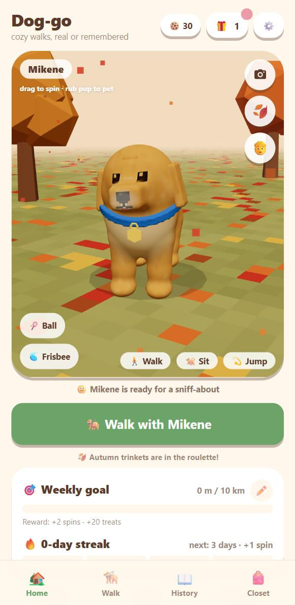
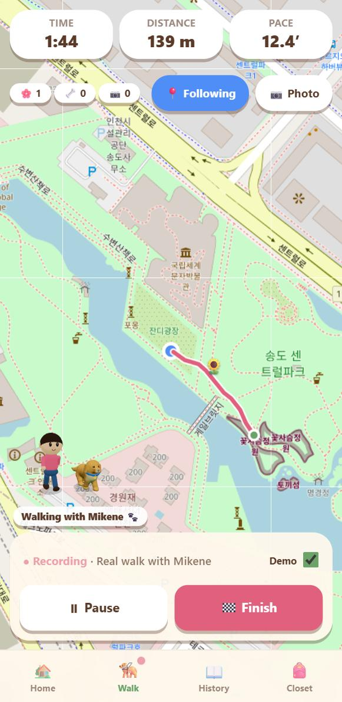

<h1 align="center">🐾 Dog-go</h1>

<p align="center"><b>A cozy dog-walking app. Walk your real dog, or walk with a 3D version of a dog who is far away or has passed.</b></p>

<p align="center">
  <a href="https://jinyoung1900.github.io/Claude-Anthology-Lab/dog-go/"><b>▶ Try it in your browser</b></a> ·
  <a href="https://github.com/jinyoung1900/Claude-Anthology-Lab/releases/tag/dog-go-v0.1"><b>📱 Download the Android APK</b></a>
</p>

<p align="center">
  
  &nbsp;
  
</p>

---

## 🐕 What you can do

1. **Make your dog.** Take a photo, drag one box over the face and one over the fur, and Dog-go builds a 3D dog from it. Tune the body length, legs, ears, tail, fluff and markings, or start from a breed (golden retriever, corgi, husky, dachshund, lab).
2. **Pick a look.** *Sculpted* (soft and round) or *Pixel* (made of cubes, with a matching blocky owner).
3. **Walk.** Real walks use GPS: your route is drawn on a map and flowers bloom along it every 100 m. Virtual walks are for a dog who is away or remembered: they trot beside you on screen and leave pawprints.
4. **Play.** Tap a ball or frisbee to hold it, then swipe up to throw. The dog waits a moment, runs after it, brings it back in its mouth and drops it at your feet. Rub the dog to pet it, or ask it to walk, sit or jump.
5. **Dress up.** Hats, glasses, collars, bandanas, scarves, medals, packs, harnesses and outfits (a dino suit, a bee, a frog, a teddy bear, a unicorn and more). Everything is shaped from the dog's own body, so it fits any dog.
6. **Change the scene.** Park, home, snow, river, beach or autumn leaves, with the season's weather (snow, petals, fireflies, falling leaves).
7. **Keep going.** Set your own weekly goal, keep a streak, spin the roulette for new trinkets and look back at every walk in the memory book.

## ✨ Why it's built this way

- **For every kind of dog bond.** It works the same whether your dog is beside you, far away or gone. A memorial dog gets a gentle 🌈 and no pressure.
- **Private by design.** No account and no server. Dogs, photos, walks and notes stay on your device, with a backup file you can save.
- **The dog is sculpted, not stitched.** Each dog is one smooth, skinned mesh built from soft shapes, with hips, knees and paws that bend as it walks, a proper sit, and floppy ears on springs that bounce when it runs.
- **Clothes come from the dog's shape.** A collar is the dog's own neck pushed out a little and trimmed to a band, so it always sits on the fur. Each neck item has its own fit, so tuning one never moves another.
- **Three languages.** English, 한국어 and Suomi.

## 🛠️ Tech

| | |
|---|---|
| **App** | Next.js (App Router, static export), TypeScript, Tailwind CSS. |
| **3D** | three.js with React Three Fiber. Dogs are signed distance fields meshed with surface nets and skinned to a skeleton (`components/three/sculpt`). Costumes are built in `components/three/costume.ts`, fetch physics in `components/three/Fetch.tsx`, scenes in `components/three/Scenery.tsx`. |
| **Maps & GPS** | Leaflet with OpenStreetMap tiles. Capacitor Geolocation and a background-geolocation plugin on Android, browser geolocation on the web, and a demo route for testing. |
| **Android** | Capacitor 7 wraps the static web build. |
| **Storage** | IndexedDB and localStorage, on the device only. |

## 🧑‍💻 Run it yourself

```sh
npm install
npm run dev            # http://localhost:3000 (turn on "Demo GPS" on the Walk tab to fake a route)
npm run android:apk    # build, sync to Android and make a debug APK
                       # -> android/app/build/outputs/apk/debug/app-debug.apk
npm run build:pages    # the web version for GitHub Pages, into out/
```

The APK needs the normal build (no base path), so run `npm run android:apk` (or `npm run build` and `npx cap sync android`) before `npm run build:pages`. The `out/` folder in this repo is the GitHub Pages build, served from `/Claude-Anthology-Lab/dog-go/out/`.

## 🧪 Testing switches

This is a test build, so a few things are switched on that should be off in a release:
- every outfit is unlocked (`UNLOCK_ALL_OUTFITS` in `app/closet/page.tsx`)
- a developer unlock for every item (15 quick taps on the Dino Suit card in the Closet)
- ads are mock banners only

## 🗺️ Status

A playable v0.1 test build for Android and the web. Not on the Play Store yet.

---

<p align="center">Part of the <a href="../">Claude Anthology Lab</a> · Made with Claude by <a href="https://github.com/jinyoung1900">Jin Young (Jack) Jeon</a></p>
