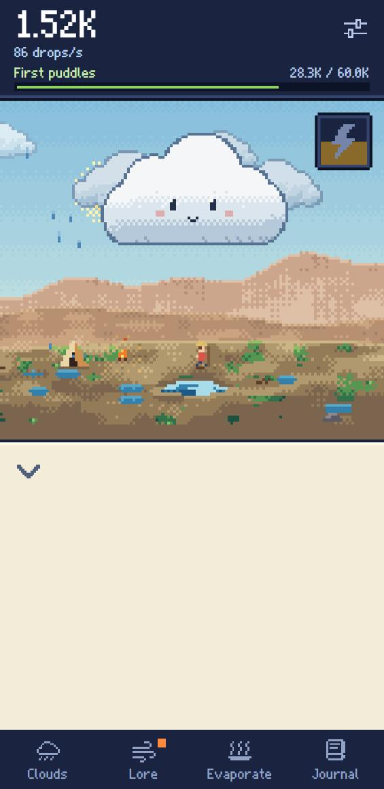
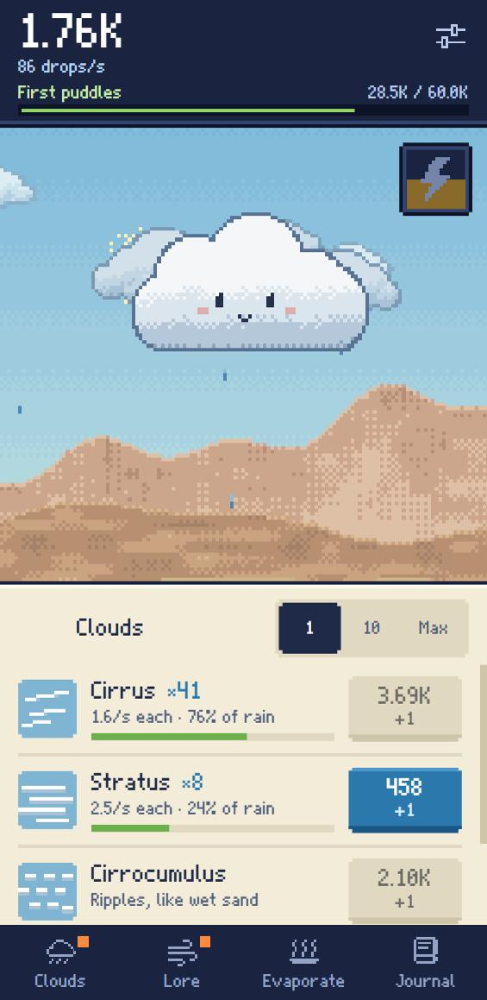

<h1 align="center">🌧️ Idle Raindrop</h1>

<p align="center"><b>A pixel-art idle game for Android. You are a small cloud. Rain on a dead valley until it lives, then evaporate and drift to the next.</b></p>

<p align="center">
  <a href="https://jinyoung1900.github.io/Claude-Anthology-Lab/idle-raindrop/"><b>▶ Play it in your browser</b></a> ·
  <a href="https://github.com/jinyoung1900/Claude-Anthology-Lab/releases/tag/idle-raindrop-v1.0"><b>📱 Download the Android APK</b></a>
</p>

<p align="center">
  
  &nbsp;
  
</p>

---

## 🎮 How to play

1. **Squeeze** the cloud (tap it) to make it rain.
2. **Condense more clouds** with your drops. Each one rains on its own, even while you're away. There are 12, all real cloud types, from wispy *Cirrus* to the *Cyclone*.
3. **Watch the valley come back.** Cracked earth turns into puddles, moss, a meadow, a stream, a lake, a forest and finally a hamlet, and people move in as it grows: a wanderer, a tent, a hut, a cabin, a dock, lanterns.
4. **Release thunder** when the bolt fills up for a burst of rain, and tap the **swallows** that fly past for a gift.
5. **Learn weather lore**: upgrades with real weather names (Mare's Tails, Mackerel Sky, Anvil Top) that boost your clouds.
6. **Evaporate** once the valley has a lake. You start over in a new valley (Dust Basin, Red Canyon, Salt Flat…) but keep **vapor**, which buys permanent perks like *Tailwind*, *Steady Drizzle* and *Night Watch*.

The **Journal** collects milestones like *It Rained All Night* (be away for 6 hours) and *Cloud Atlas* (own every kind of cloud).

## ✨ Why it's built this way

- **Calm, not grindy.** No energy bars or nagging timers. Rain keeps falling for up to 8 hours while you're away, and there's always a small story beat on screen (*"A tent goes up. Somebody splashes."*).
- **Real weather.** Every cloud, upgrade and lore card is named after real meteorology, so you pick up a bit of cloud spotting as you play.
- **Everything is drawn in code.** The pixel art (the cloud, the valley, the 16×16 lore pictures, the icons and even the font) is generated by JavaScript on a canvas. There are no image files in the game.
- **Fair ads.** Only opt-in rewarded videos (double a swallow's gift, double the rain from being away, +25% vapor). No banners, no forced ads, and offers only appear when an ad is actually ready.

## 🛠️ Tech

| | |
|---|---|
| **Game** | Plain JavaScript, HTML and CSS, no libraries (`app/src/main/assets/game`). `core.js` holds the rules with no DOM, so Node can test and balance it. `scene.js` draws the pixel world, `ui.js` the interface, `audio.js` the sound, `font.js` the pixel font, `icons.js` the icons, `lore.js` the lore pictures. |
| **Android** | A thin Java shell (`MainActivity.java`) that hosts the game in a WebView, Android 9+. Ads via Google AdMob + UMP consent (`Ads.java`). |
| **Tests** | `node tools/test.js` checks the rules (save loading, bulk prices, offline rain…). `node tools/sim.js <hours> <taps/s>` lets a bot play for hours to check the balance. |

## 🧑‍💻 Run it yourself

```sh
node tools/serve.js          # play in a browser at http://localhost:8137 (add ?ads to try the ad offers)
node tools/test.js           # rule tests
node tools/sim.js 6 1.5      # balance bot: 6 hours at 1.5 taps per second
node tools/build-font.js     # after editing font.js
node tools/build-icon.js     # rebuild the launcher icon
```

**Android build**: open the folder in Android Studio, or run `sh build.sh assembleDebug` from Git Bash (it uses the Gradle that ships with Unity; edit the paths at the top of `build.sh` for your machine). `run-emulator.cmd` starts the emulator and installs the debug build.

**Play Store release**: add a `keystore.properties` (see `app/build.gradle`), then `sh build.sh bundleRelease`. Before publishing, put your own AdMob app id and rewarded unit id in `app/src/main/res/values/ads.xml` (the repo uses Google's public test ids), add a consent message in AdMob, host a privacy policy, and declare ads and the advertising ID in Play Console.

## 🗺️ Status

A complete, playable v1.0 debug build. Not on the Play Store yet.

---

<p align="center">Part of the <a href="../">Claude Anthology Lab</a> · Made with Claude by <a href="https://github.com/jinyoung1900">Jin Young (Jack) Jeon</a></p>
