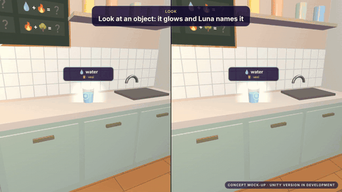

<h1 align="center">🌙 Luna's Magic Lab</h1>

<b>Kids don't point at labelled objects here. They <i>craft</i> words: look around a 360° room, reveal hidden 3D shapes and mix them into new ones (☀️ sun + ⭐ star = 🚀 rocket), like <i>Little Alchemy</i> in VR.</b> 
It runs controller-free on a phone in a Google Cardboard viewer, so a whole class can play with phones and cheap viewers instead of sharing one €360 headset.

<b>English · 한국어 · Suomi</b> &nbsp;(plus Español)

  <a href="https://jinyoung1900.github.io/Claude-Anthology-Lab/lunas-magic-lab/"><b>▶ Play it in your browser</b></a> ·
  <a href="media/demo.mp4"><b>🎬 Watch the demo video</b></a>

  

---

## 🧩 What makes it different

Most VR language apps teach vocabulary by **receiving** it. In *Noun Town* you learn the names of objects around a town, with mini-games and spaced repetition. In *Mondly VR* you practise scripted conversations with chatbot characters. Today both are sold for headsets such as Meta Quest.

Luna's Magic Lab teaches vocabulary by **making** it:

| | Typical VR language app | Luna's Magic Lab |
|---|---|---|
| **Core loop** | Point at an object or answer a character, hear the word | **Look → Reveal → Teleport → Mix**: find hidden shapes, combine two words into a third |
| **Why kids keep going** | Lessons, streaks and scores | Curiosity: *what do sun + star make?* 10 secret recipes to discover |
| **Hardware** | Standalone headset (Meta Quest 3S: €359.99) plus controllers | Any phone + a €10–20 Google Cardboard viewer |
| **Input** | Headset controllers or hand tracking | **Zero controllers**: gaze to aim, one Activate button, blink teleport |
| **Languages** | Usually one target language at a time | **English · 한국어 · Suomi** side by side, so kids compare Latin and Hangul scripts and sounds through play |

## 🥽 Why VR? (RIDE framework)

VR is worth it when the experience is **R**are, **I**mpossible, **D**angerous or **E**xpensive in real life. Luna's Magic Lab hits all four:

| | Why it applies |
|---|---|
| 🔍 **Rare** | One-on-one, fully immersive spatial play usually means a headset per child or a turn in a VR lab. With Cardboard, every child gets their own 360° room at the same time. |
| ✨ **Impossible** | You can't mix a sun and a star into a rocket, hold the moon, or watch a seed grow into a tree in seconds. In VR these word transformations happen in space around the child, and searching the room for hidden wireframes makes each word a place you found, not a card you flipped. |
| 🔥 **Dangerous** | Fire, a campfire, a tiger and a rocket launch can all be handled up close with no risk. The design keeps bodies safe too: kids select by gaze while standing or sitting still, move by **blink teleport** with a short fade instead of smooth walking (which can cause motion sickness), and objects grow in gently instead of bouncing. |
| 💶 **Expensive** | A standalone headset costs around €360 per child, and a VR lab far more. Luna's Magic Lab needs a phone and a €10–20 Cardboard viewer, so a class set of viewers costs about the same as one headset. |

## 🎮 How to play

**Google Cardboard (the main way to play)**
1. Open the [live demo](https://jinyoung1900.github.io/Claude-Anthology-Lab/lunas-magic-lab/) on your phone, press **Start the magic**, then **Cardboard VR**, and put the phone in the viewer.
2. **Look** around: mystery shapes made of glowing dots hide around the room.
3. **Reveal**: look at a shape for about a second until it glows, then press **Activate** twice.
4. **Teleport**: look at the floor until a ring appears, then press **Activate** to jump there.
5. **Mix**: look at one revealed shape, press **Activate**, then look at a second shape and press again. Your selection stays while you teleport.
6. Look at **Luna** and press once for a hint, press again and she listens to you, and press a third time to cancel.

**Phone or desktop browser (no viewer)**: tap a word chip, type to Luna, or press 🎤 and speak. Drag to look around, and walk with **WASD**, the arrow keys or the on-screen pad.

### 🧪 The 10 recipes

| Mix | | Get |
|---|---|---|
| 🍎 Apple + 🌙 Luna | → | 🌱 Seed |
| 🌱 Seed + 🌧️ Rain | → | 🌳 Tree |
| ⭐ Star + ☀️ Sun | → | 🚀 Rocket |
| 🌧️ Rain + ☀️ Sun | → | 🌈 Rainbow |
| 🕒 Clock + ⭐ Star | → | 🔮 Magic orb |
| 💧 Water + 🔥 Fire | → | ☁️ Cloud |
| ☁️ Cloud + ⭐ Star | → | 🌙 Moon |
| 📖 Book + 🔮 Magic orb | → | 🧙 Wizard hat |
| 🐱 Cat + ☀️ Sun | → | 🐅 Tiger |
| 🔥 Fire + 🌳 Tree | → | 🏕️ Campfire |

## 🌐 Languages

**English · 한국어 · Suomi** are the focus, with Español as a bonus language. Switch at any time: Luna's lines, the word chips, the hints and the vocabulary all change.
- **Korean** hints use the right particles for each word (별**과** 해**를** 섞어 봐요!), and children can type or say words in Hangul.
- **Voices** come from the device's text-to-speech. Most Android phones include Korean and English. If a Finnish voice is missing, Luna reads Finnish with an English voice. If a Korean voice is missing, she shows a note saying how to install one.

## 🗺️ MVP status vs. future Unity version

**This build is an interactive MVP made in Claude** (a single-file Claude artifact) to test whether the *Look · Reveal · Teleport · Mix* loop is fun and understandable for kids.

| | ✅ Now: Claude artifact MVP | 🔜 Next: full Unity VR version |
|---|---|---|
| **Goal** | Prove the core word-crafting loop quickly | A polished classroom-ready app |
| **World** | Mystery objects **float on a minimal purple ground plane**: fast to prototype, but abstract | Everyday 3D objects **grounded naturally inside rich themed rooms**, such as a bedroom, a kitchen or an observatory, so each word is anchored in real-world spatial memory |
| **Interaction** | Gaze + one Activate button, blink teleport | Look at an object and tilt your head to grab, move your head to carry, tilt again to drop; teleport by looking at the ground |
| **Guidance** | Luna gives spoken hints | Plus a recipe board that shows every combination |
| **Voice** | Device text-to-speech | Luna's voice and word audio prepared in advance |
| **Platform** | Any phone browser + Cardboard, no install | Android app + Google Cardboard |

### 🎬 Concept preview: how the Unity version could play

> ⚠️ **This is a concept mock-up, not Unity footage.** It was made as a 3D web scene to plan the final build, and the video is labelled as a mock-up throughout.

   
  <a href="media/concept-unity-preview.mp4"><b>▶ Watch the full concept video (35 s)</b></a>

The concept shows one themed room, a kitchen, played in Google Cardboard:
1. **Grounded objects:** a glass of water on the counter, fire on the stove, apples in a bowl, a cat on the rug, and Luna by the window.
2. **Teleport:** look at the floor and press to blink across the room.
3. **Look:** the glass glows and its name appears in three languages (💧 water · 물 · vesi).
4. **Grab and carry:** tilt your head to pick the glass up, then move your head to carry it.
5. **Mix:** tilt again to drop it on the fire, and water + fire = ☁️ cloud (구름 · pilvi).
6. **Recipe board:** the new recipe is ticked off on the wall.
7. **Speak:** Luna cheers and asks the child to say the new word.

## 🛠️ Tech

| Part | How |
|---|---|
| App | One self-contained `index.html` with no build step and no backend |
| 3D | [Three.js](https://threejs.org/) r128. Every object (Luna, clock, rocket, tiger…) is built from code, with no 3D model files |
| Cardboard VR | Split-screen stereo rendering, `DeviceOrientation` head tracking, gaze-dwell selection and floor-gaze teleport |
| Voice | Web Speech API: speech synthesis for Luna, speech recognition for the child's answers |
| Also | Enter VR works in WebXR headset browsers. Lucide icons |
| Built with | Claude, as a Claude artifact, through many rounds of prompting, testing and fixing |

> **About Luna's replies.** When the app runs inside Claude as an artifact, Luna can use Claude to answer free-form questions. Everywhere else, including this GitHub Pages version, she uses built-in replies, so there is no AI service and nothing to set up.

## 🎓 Context

Built for the *VR Systems and Humans* course at the University of Oulu, following basic Meta/Oculus VR design guidelines: gaze dwell before selecting, a fixed reticle, teleport instead of smooth locomotion, soft lighting and grounding shadows, and objects spaced so they never overlap.

**Run it locally:** download `index.html` and open it in a browser. It loads Three.js and Lucide from a CDN, so you need an internet connection.

---

Part of <a href="../">✒️ Claude Anthology Lab</a> · Made by <a href="https://github.com/jinyoung1900">Jin Young (Jack) Jeon</a>

