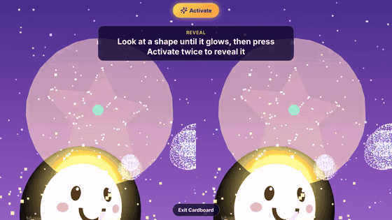

<h1 align="center">🌙 Luna's Magic Lab</h1>

<b>A VR word-crafting game for kids.</b> Meet Luna, a glowing moon teacher, ask her for words, and mix objects together to discover new ones in English, Spanish, Finnish and Korean.

  <a href="https://jinyoung1900.github.io/Claude-Anthology-Lab/lunas-magic-lab/"><b>▶ Play it in your browser</b></a> ·
  <a href="media/demo.mp4"><b>🎬 Watch the demo video</b></a>

  

---

## ✨ What it does

- **Talk or tap to learn words.** Ask Luna for something ("I want an apple!", "Make it rain!") and it appears in 3D while Luna says the word and asks the child to repeat it.
- **Four languages.** Switch between English, Español, Suomi and 한국어 at any time. Luna's lines, the word chips, the hints and the vocabulary all change. Korean hints use the right particles (와/과, 을/를) for each word, and children can type or say words in Hangul.
- **Mix and discover.** In VR mode, mystery shapes hide around the room. Reveal them, then pick two to combine them into something new. There are 10 recipes to find.
- **Teleport around the room.** In Cardboard VR, look at the floor, then press Activate to blink to that spot. No joystick needed, and no motion sickness from smooth walking.
- **Progress kids can see.** Luna's Memory panel tracks words learned, streaks, recipes found and a level (Sprout → Explorer → Wizard → Star Mage → Moon Master).
- **Plays anywhere.** It runs on a desktop browser, on a phone, on a phone in a Google Cardboard viewer, and in WebXR headsets such as Meta Quest.

## 🎮 How to play

**Desktop or phone**
1. Open the [live demo](https://jinyoung1900.github.io/Claude-Anthology-Lab/lunas-magic-lab/) and press **Start the magic**.
2. Tap a word chip, type to Luna, or press the 🎤 button and speak.
3. Drag to look around. Walk with **WASD** or the arrow keys (or the on-screen pad), and use **Q / E** to fly down or up.

**Cardboard VR** (phone in a viewer)
1. Press **Cardboard VR** and put the phone in the viewer. Move your head to aim the dot in the middle.
2. Look at a mystery shape for about a second until it glows, then press **Activate** twice to reveal it.
3. **Teleport:** look at the floor until a glowing ring appears, then press **Activate** to jump there.
4. Look at one revealed shape, press Activate, then look at a second shape and press Activate again to **mix** them. Your selection stays while you teleport, so you can walk over to the second shape.
5. Look at **Luna** and press once for a hint, press again and she listens to you, and press a third time to cancel.

**WebXR headset** (for example Meta Quest Browser): press **Enter VR**. Point and pull the trigger to grab objects, and squeeze to turn Luna into a pocket-sized orb companion.

### 🧪 The 10 recipes

| Mix | | Get |
|---|---|---|
| 🍎 Apple + 🌙 Luna | → | 🌱 Seed |
| 🌱 Seed + 🌧️ Rain | → | 🌳 Tree |
| ⭐ Star + ☀️ Sun | → | 🚀 Rocket |
| 🌧️ Rain + ☀️ Sun | → | 🌈 Rainbow |
| 🕒 Clock + ⭐ Star | → | 🔮 Magic orb |
| 💧 Water + 🔥 Fire | → | ☁️ Cloud |
| ☁️ Cloud + ⭐ Star | → | 🌙 Moon |
| 📖 Book + 🔮 Magic orb | → | 🧙 Wizard hat |
| 🐱 Cat + ☀️ Sun | → | 🐅 Tiger |
| 🔥 Fire + 🌳 Tree | → | 🏕️ Campfire |

## 💡 Why I built it this way

- **Learning by doing.** Instead of memorising a list, the child makes things happen: asking for a word spawns it, and mixing two words creates a third. Every new word comes from an action.
- **Discovery keeps it going.** Hidden shapes and secret recipes give a reason to keep exploring, and Luna nudges with hints when a child gets stuck.
- **Low barrier for families.** It's one web page with no install, no account and no API key. A phone and a cheap Cardboard viewer are enough for VR.
- **Comfortable VR.** Selecting works by gaze, and moving works by blink teleport with a short fade, not smooth walking, which can make people feel sick in VR. Objects grow in gently and float softly instead of bouncing.
- **A friendly guide.** Luna is a warm character who praises, hints and repeats words, so the child is never alone with a menu.
- **Course project.** It was built for the *VR Systems and Humans* course at the University of Oulu and follows basic Meta/Oculus VR design guidelines: gaze dwell before selecting, a fixed reticle, teleport instead of smooth locomotion, soft lighting and grounding shadows, and objects spaced out so they never overlap.

## 🛠️ Tech

| Part | How |
|---|---|
| App | One self-contained `index.html` with no build step and no backend |
| 3D | [Three.js](https://threejs.org/) r128. Every object (Luna, clock, rocket, tiger…) is built from code, with no 3D model files |
| Icons | [Lucide](https://lucide.dev/) |
| Voice | Web Speech API: speech synthesis for Luna's voice, speech recognition for the child's answers |
| VR | WebXR for headsets. For Cardboard, split-screen stereo rendering, `DeviceOrientation` head tracking, gaze selection and floor-gaze teleport |
| Built with | Claude, as a Claude artifact, through many rounds of prompting, testing and fixing |

> **About Luna's replies.** When the app runs inside Claude as an artifact, Luna can use Claude to answer free-form questions. Everywhere else, including this GitHub Pages version, she uses built-in replies, so nothing needs to be set up.

**Browser notes:** Voice input works best in Chrome or Edge. If Finnish sounds wrong, install a Finnish text-to-speech voice on the device; until then, Luna reads Finnish words with an English voice. Korean works the same way: Luna uses the device's Korean voice, which most Android phones and Chrome already have.

## 🗺️ What's next

A **Unity version for Android phones with Google Cardboard** is in progress. It will add head-tilt grabbing, a recipe board, and pre-recorded voice lines.

## ▶️ Run it locally

Download `index.html` and open it in a browser. It loads Three.js and Lucide from a CDN, so you need an internet connection.

---

Part of <a href="../">✒️ Claude Anthology Lab</a> · Made by <a href="https://github.com/jinyoung1900">Jin Young (Jack) Jeon</a>

